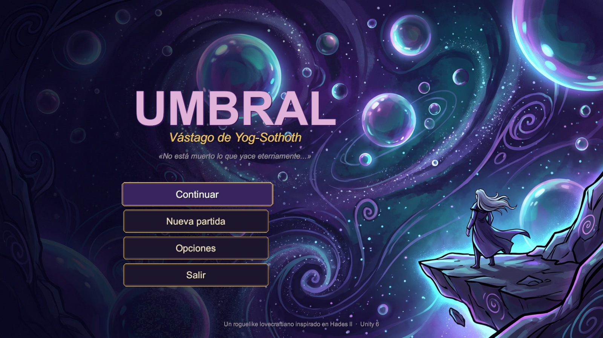
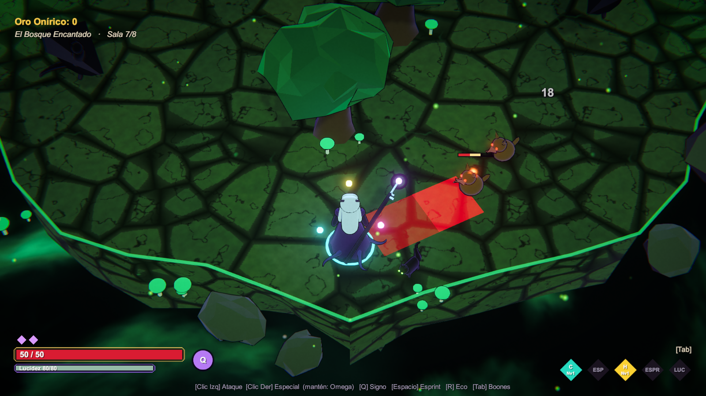
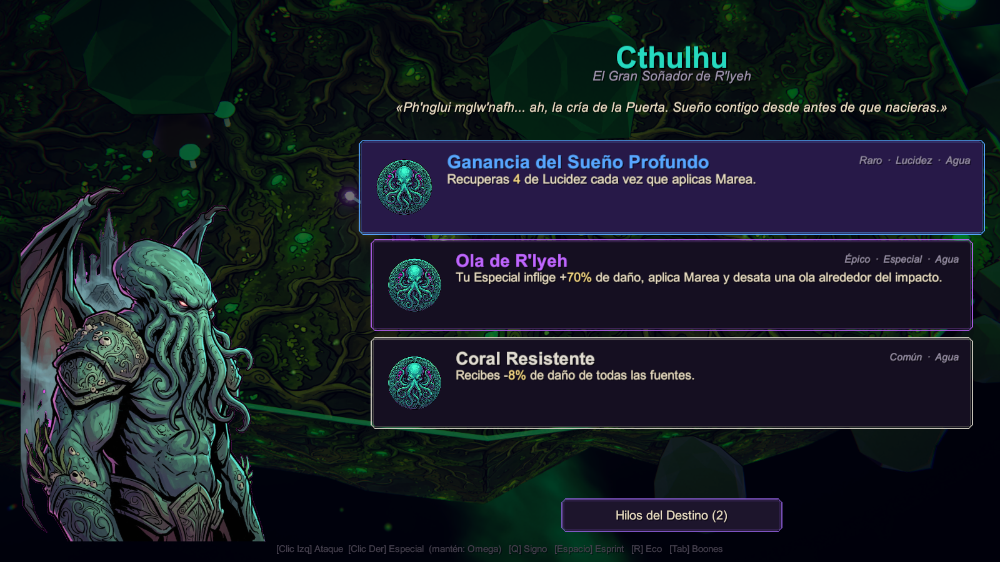
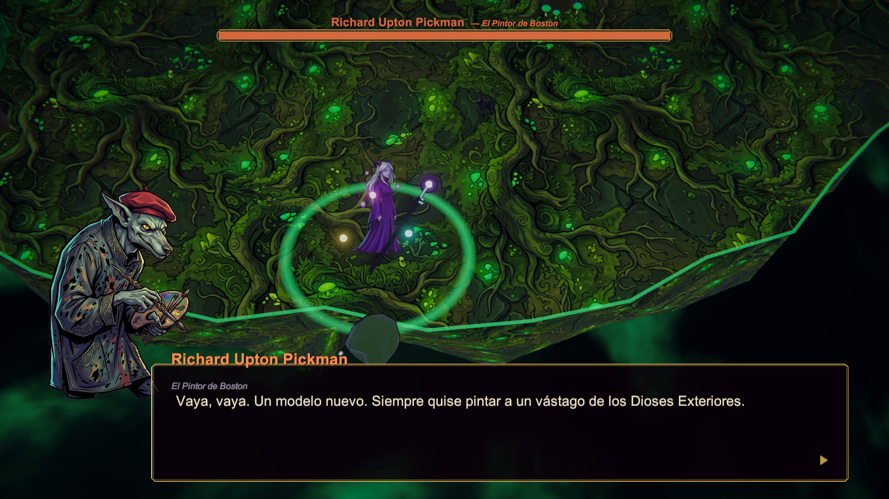
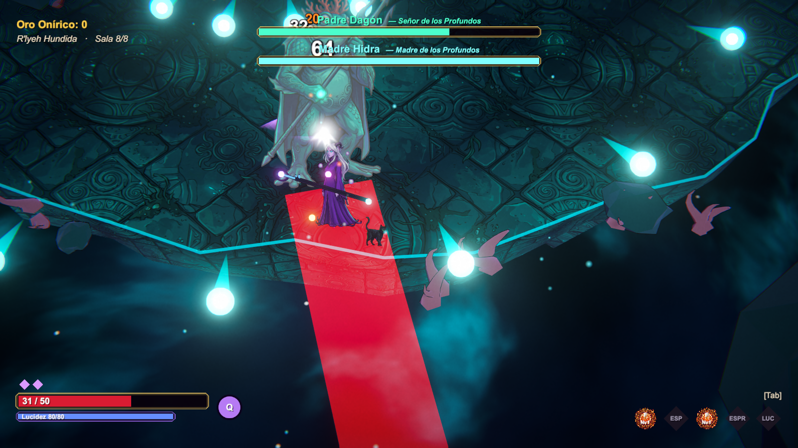
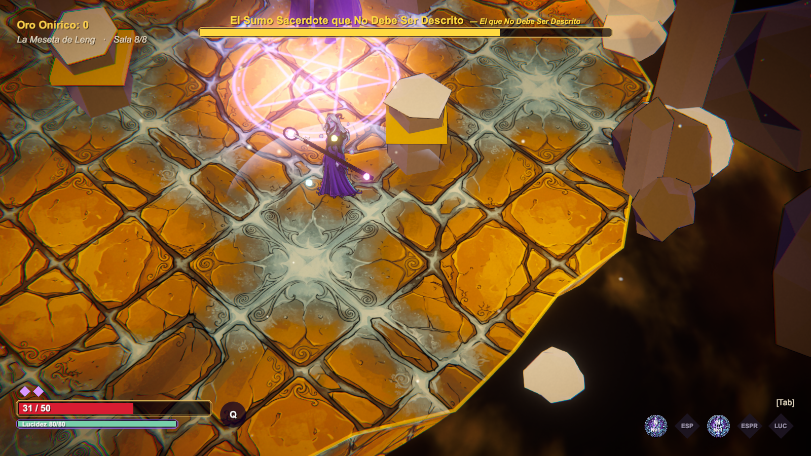
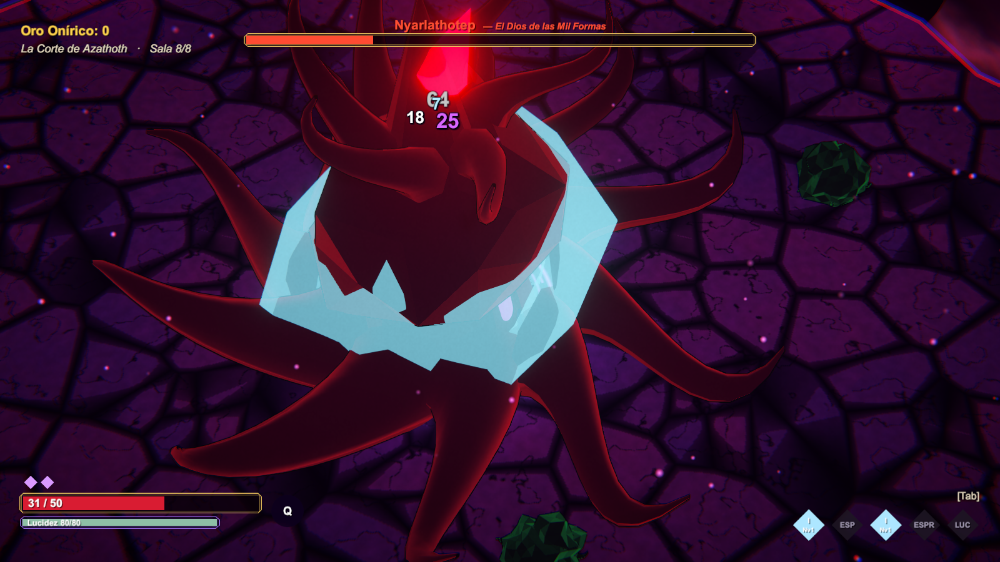
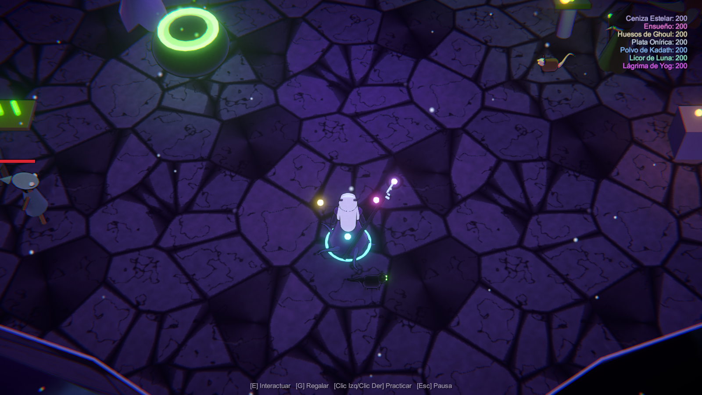

# UMBRAL — Vástago de Yog-Sothoth

Roguelike de acción isométrico para **Unity 6** inspirado en el combate, las mecánicas y la estructura de **Hades II**, con temática de **H. P. Lovecraft**.

Eres **Sothis Whateley** (hijo o hija, a elegir), el tercer vástago de Lavinia Whateley y **Yog-Sothoth**, nacido en el espacio entre los espacios. Tus hermanos Wilbur y "el Otro" cruzaron al mundo de vigilia y murieron allí. Tú quieres escapar: atravesar las Tierras del Sueño, la R'lyeh hundida, la meseta de Leng y la Corte de Azathoth hasta la Última Puerta, que custodia **Nyarlathotep**. Cada vez que mueres, la Puerta te devuelve al Umbral, como la sangre de tu padre manda.

| | |
|---|---|
|  |  |
|  |  |
|  |  |
|  |  |

---

## Cómo abrirlo y jugar

1. Abre **Unity Hub → Add → Add project from disk** y elige esta carpeta (versión del editor: `6000.6.5f1`; cualquier Unity 6.x reciente debería servir).
2. Al abrirse, el proyecto se configura solo (URP, escena y ajustes). Si no, usa el menú **Umbral → Configurar proyecto**.
3. Abre `Assets/Umbral/Scenes/Umbral.unity` y pulsa **Play**.
   - En realidad funciona desde cualquier escena: el juego se monta entero por código al pulsar Play.
4. Para crear un ejecutable: **Umbral → Construir para Windows** (sale en `Builds/Windows/UMBRAL.exe`).

No hace falta ningún asset externo: **todo el arte, las animaciones, los retratos, los efectos, el sonido y la música se generan por código**.

**Arte pintado opcional:** puedes sustituir retratos, personajes, iconos, fondos y suelos por ilustraciones hechas con Nano Banana Pro (u otra herramienta). Solo hay que guardar las imágenes con el nombre correcto en `Assets/Umbral/Resources/ArtIA/`: el juego quita el fondo y las usa solo. Prompts y nombres en [docs/ARTE_IA.md](docs/ARTE_IA.md).

### Controles

| Acción | Teclado y ratón | Mando |
|---|---|---|
| Moverse | WASD / flechas | Stick izquierdo |
| Apuntar | Ratón | Stick derecho (con asistencia) |
| Ataque / **Omega** (mantener) | Clic izquierdo / J | X |
| Especial / **Omega** (mantener) | Clic derecho / K | Y |
| Signo Arcano (lanzamiento) / Omega (mantener) | Q / L | RB |
| Esprint (embestida invulnerable + carrera) | Espacio / Shift | A |
| Eco del Padre (hex) | R / F | LB |
| Interactuar / Regalar | E / G | B / Cruceta ↑ |
| Boones / Pausa | Tab / Esc | Select / Start |

---

## Qué incluye

**Combate (como Hades II)**
- 5 armas con Ataque, Especial y sus versiones **Omega** (mantener pulsado, gastan **Lucidez** = la Magia de Hades II): Báculo de la Llave de Plata, Colmillos de Tindalos (críticos por la espalda), Necronomicón (llamas teledirigidas y glifos), Hoz de Leng (guardia + contraataque, torbellino, salto) y Trapezoedro Resplandeciente (munición que hay que recoger).
- Cada arma: 2 **aspectos** con 3 niveles y 6–7 mejoras de **Fragmento de Eltdown** (el Martillo de Dédalo).
- **Signo Arcano** (el Signo de los Primigenios) que ata a los enemigos, como el lanzamiento de Melinoë.
- **Esprint** con embestida invulnerable, búfer de entrada, cancelación de ataques, congelación de golpe, temblor de cámara, números de daño y críticos ×3.
- Avisos en el suelo para cada ataque enemigo (zona roja que se llena).

**Favores divinos (boones)**
- 6 dioses lovecraftianos con su maldición: **Cthulhu** (Marea), **Hastur** (Locura), **Shub-Niggurath** (Semilla → Retoños aliados), **Nodens** (Sentencia, rayos), **Ithaqua** (Escarcha → Congelado), **Cthugha** (Llama Viva).
- Ranuras Ataque / Especial / Signo / Esprint / Lucidez, pasivos, **infusiones** por elemento (Tierra, Agua, Aire, Fuego, Éter), **legendarios** y **10 dúos**. Rarezas Común/Raro/Épico/Heroico, subida de nivel con **Frutos Oscuros**.
- **Gatos de Ulthar** (como Hermes), **Puertas de Azathoth** (como el Caos: bendición + maldición temporal) y **Ecos del Padre** (como los hechizos de Selene, se cargan gastando Lucidez).

**Incursión**
- 4 regiones de 8 salas + guardián: Bosque Encantado → R'lyeh Hundida → Meseta de Leng → Corte de Azathoth.
- Puertas que muestran la recompensa de la siguiente sala, salas de élite, tienda (Galeras Negras de Leng), fuentes, antesala del jefe y rival recurrente (el **Eco de Wilbur Whateley**, como Némesis).
- 18 tipos de enemigo y 5 jefes con fases: **Pickman**, **Padre Dagón y Madre Hidra** (combate doble), **el Sumo Sacerdote que No Debe Ser Descrito**, **Nyarlathotep** (Faraón Negro → Morador de las Tinieblas → Dios de las Mil Formas) y Wilbur.

**El Umbral (santuario, como la Encrucijada)**
- **Grimorio de Keziah** (Cartas Arcanas con Capacidad mental), **Caldero** (21 rituales que desbloquean contenido), **Altar de armas y aspectos**, **Juramento de lo Innombrable** (pactos de Pavor), **Reliquias** (recuerdos) y **familiares** (Ébano el gato y Pipo el zoog), **Presagios** (lista de profecías), **Necronomicón** (códice), **mercado de Herbert West** y **monigote de práctica** con medidor de daño.
- Allegados con diálogos que avanzan con tu progreso y regalos de **Licor de Luna** (néctar): 'Umr at-Tawil, Randolph Carter, Keziah Mason, Brown Jenkin, Zadok Allen, Herbert West y Wilbur.
- Retratos pintados por código para cada personaje, dios y jefe; textos adaptados a hijo/hija.
- Guardado automático; opciones de volumen, temblor, números de daño y **Modo Dios** (accesibilidad, como en Hades).

---

## Estructura del código

```
Assets/Umbral/
  Scripts/                (ensamblado Umbral.Runtime)
    Core/       Game (bucle principal), entrada, cámara, física de arena, audio sintetizado, prueba automática
    Art/        shaders y materiales, texturas/mallas procedurales, modelos de personajes/enemigos, retratos, efectos, atrezo
    Combat/     daño, estados alterados, proyectiles, zonas
    Player/     protagonista, Signo Arcano, Ecos, aliados y familiares
    Weapons/    las 5 armas, aspectos y mejoras
    Boons/      dioses, catálogo de boones, modificadores y ofertas
    Enemies/    datos del bestiario, IA y ejecutor de ataques
    Bosses/     guardianes y rival
    Run/        regiones, generación de salas, oleadas, puertas y recompensas, tienda
    Meta/       guardado y progresión permanente
    Narrative/  personajes y diálogos
    Hub/        el santuario
    UI/         HUD, menús, diálogos, elecciones de boon
  Resources/Shaders/      Umbral/Toon (cel + contorno de tinta), Umbral/Unlit, Umbral/Void (abismo cósmico)
  Editor/                 configuración automática del proyecto y build
```

Todo el contenido está en datos C# fáciles de editar: `BoonDB.cs`, `EnemyDB.cs`, `Weapons.cs`, `MetaDB.cs`, `Biomes.cs`, `Narrative.cs`.

Más detalles en [docs/DISENO.md](docs/DISENO.md).

### Prueba automática

El ejecutable acepta `-umbral-smoke -umbral-out <carpeta>`: juega solo (menú, santuario, las 5 armas, los 4 guardianes y la muerte), guarda capturas y un registro de errores. Usa una ranura de guardado separada.
